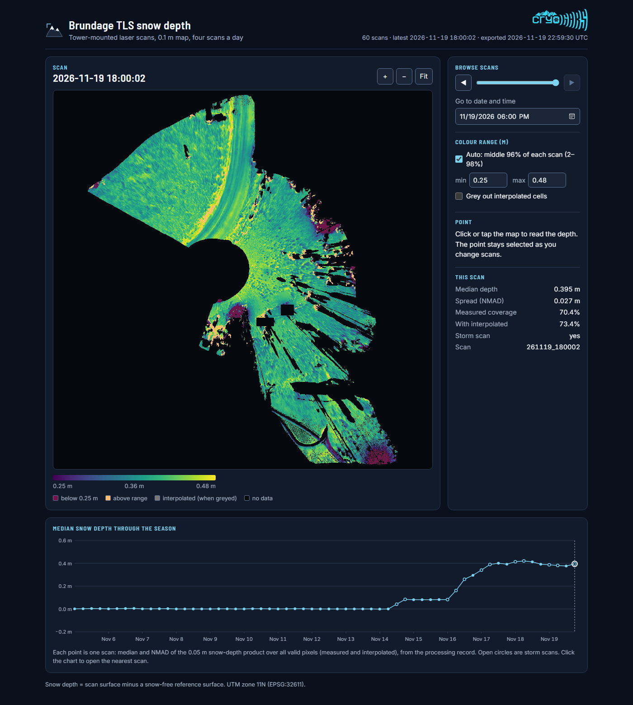

# Brundage TLS snow depth

Interactive viewer for snow depth from the CRYOGARS Lab tower-mounted terrestrial laser scanner
(TLS) at Brundage. The scanner surveys the slope four times a day; each scan is turned into a
snow-depth map (scan surface minus a snow-free reference surface). Browse the scans, click the
map to read the depth at a point, and follow the median depth through the season.

**Viewer:** https://tvanderweide.github.io/brundage-tls/

New scans are processed automatically and published hourly to the `gh-pages` branch, which holds
the site and its data. Maps are 0.1 m, UTM zone 11N (EPSG:32611). Data are automated and not
quality controlled.
